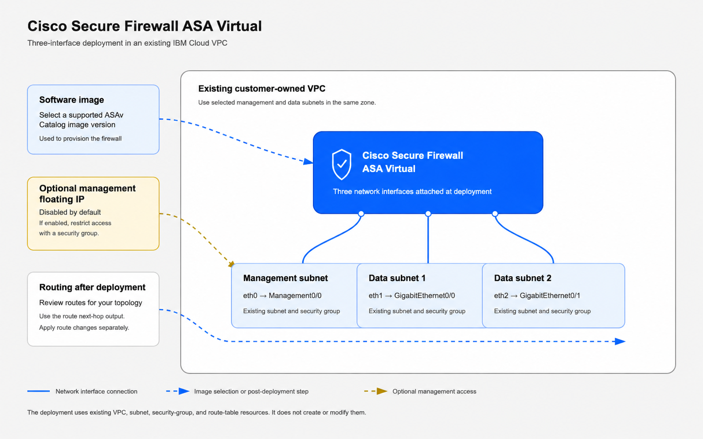

# Cisco Secure Firewall ASA Virtual — existing VPC

Deploy one three-interface ASAv from a Cisco VSI Catalog version into your existing IBM Cloud VPC. Obtain ASAv BYOL entitlement and eligible Cisco support separately.



| IBM interface | ASAv interface | Role |
|---|---|---|
| `eth0` (primary) | `Management0/0` | Management |
| `eth1` | `GigabitEthernet0/0` | Data-1; customer-defined |
| `eth2` | `GigabitEthernet0/1` | Data-2; customer-defined |

## Before you begin

### Prerequisites and IAM

Prepare an existing resource group, VPC, three distinct subnets in the same VPC/zone, security groups in that VPC, and one regional VPC SSH-key registration. The selected image/profile must be available in the zone, support three attachments and fit your account quota. Arrange a management access path.

| Scope | Required access |
|---|---|
| VPC deployment resources | Create/update/delete access for the VSI, VNIs, boot volume and optional floating IP; appropriate access to the existing VPC, subnets, SGs, keys and profiles. The default VNI settings require **Virtual Network Interface → Administrator**, or equivalent custom actions. Scope access to the deployment resources where possible. |
| Selected Cisco VSI offering | Catalog read access and entitlement to consume the selected version. |
| Target resource group | Viewer access to resolve the group by name. |

Custom roles must include `is.virtual-network-interface.virtual-network-interface.manage-ip-spoofing` and `is.virtual-network-interface.virtual-network-interface.manage-protocol-state-filtering-mode`. The older instance IP-spoofing permission alone is insufficient. This template does not grant IAM access.

### Authentication and naming

Configure the deployment identity in the Software/Schematics flow. `ibmcloud_api_key` is an optional sensitive override; when omitted, the provider uses its environment/runtime credentials. For local Terraform, use `IC_API_KEY` or `IBMCLOUD_API_KEY`. Confirm the effective account and permissions. See [provider authentication](https://cloud.ibm.com/docs/ibm-cloud-provider-for-terraform?topic=ibm-cloud-provider-for-terraform-provider-reference).

Set **Resource name prefix** (`resource_name_prefix`) to a unique prefix of 1–35 lowercase letters, digits, or hyphens. Start with a letter and avoid consecutive or trailing hyphens. If the Catalog generates a value such as `cisco-asav-123ab` for a new install, you can edit it. Terraform uses the supplied value before resource suffixes such as `-vsi` and `-mgmt-vni`. Direct Terraform calls can still use the deprecated `prefix` input. If both inputs are omitted, Terraform uses `cisco-asav`.

### Network and first access

- Permit management SSH (TCP 22), and HTTPS/ASDM (TCP 443) when configured, only from approved administrator sources. A floating IP does not create SG rules or guest access policy.
- This image requires metadata enabled over **HTTP**, hop limit 1. Permit outbound TCP 80 from the management interface to `169.254.169.254/32`; HTTPS metadata is not supported by this package's image contract.
- With the default inputs, all three VNIs allow IP spoofing, disable protocol state filtering and enable infrastructure NAT. Customer SGs, ACLs, routes and ASAv policy still control the traffic path.

Customize [the Day-0 example](bootstrap/asav-day0.example.txt), including its inline RSA public key and SSH/AAA settings. Selecting an IBM SSH-key ID alone does not establish a usable guest login. If omitting Day-0, arrange console access or another verified first-configuration path. Submit raw text, not Base64.

For direct Day-0 entry in the Catalog, turn off **Use a secret?**, open **Edit secure value**, and paste the startup configuration as plain text. To use an existing Secrets Manager secret, leave **Use a secret?** on and choose **Select from Secrets Manager**.

`user_data` is sensitive but can remain in workspace/Terraform state. Keep private keys, API keys and reusable credentials out of the published package. See [IBM VPC user data](https://cloud.ibm.com/docs/vpc?topic=vpc-user-data).

### Image and runtime choices

Choose an `asav_image_version` label from [asav-images.json](asav-images.json). Omitted/null values use its `default_version`; an explicit retained label pins the image. Empty strings and arbitrary custom-image IDs/CRNs are not accepted. Use that entry's supported regions, profiles and Secure Boot modes; live profile availability is also checked during planning.

Terraform defaults are `region = "us-east"`, `instance_profile = "cx3d-2x5"`, `enable_secure_boot = true` and `create_management_floating_ip = false`. Image compatibility lists do not change these input defaults. Requires Terraform `>= 1.13.4, < 1.14.0` and IBM provider `2.4.0`. In the Software version settings, select the Terraform `1.13` runtime series; Schematics manages its patch version. Confirm the actual runtime in the job logs. See [variables.tf](variables.tf) for the complete input schema.

## Required resources

Prepare an existing resource group, VPC, three subnet and security-group pairs, and one VPC SSH key registered in the deployment region. Terraform reads the existing resources and creates the ASAv VSI, boot volume, three VNIs, and optional management floating IP. Terraform keeps existing subnets, security groups, ACLs, gateways, and routes intact.

### Catalog deployment input checklist

1. **Required · Placement.** Set Deployment region, Resource name prefix, and Deployment resource group. Choose an existing VPC in Deployment region.
2. **Required · Network interfaces.** Select a subnet and enter its security group ID for each interface (management, data 1, and data 2). Use three distinct subnets in the selected VPC and the same availability zone. If you change the VPC, reselect the subnets and enter the matching security group IDs.
3. **Required · Access.** Choose one VPC SSH key registered in Deployment region. If you change regions, choose both the VPC and SSH key again for the new region.
4. **Required · Appliance.** Confirm the prefilled ASAv image and select a compatible virtual server profile.
5. **Optional · Management and tags.** Review the management floating IP, ASAv Day-0 configuration, and Appliance tags.

VPC and SSH key pickers can list resources from multiple regions. Match the region in each selection to Deployment region. If the form asks for an ID, enter the resource ID as a single string. Local Terraform users supply `vpc_id` and `ssh_key_id` as individual string values. The Schematics workspace location, resource group, and tags apply to the workspace. Deployment region, Deployment resource group, and Appliance tags apply to the appliance resources.

## Installing the software

1. Open the Software Terraform offer/version available to your account and configure the deployment workspace and identity.
2. Complete the Catalog deployment input checklist and review your management access path.
3. Review the plan and available cost estimate, then deploy.
4. Inspect `selected_asav_image`, `interface_map` and `management_floating_ip`. Through management access, run `show version`, `show vm` and `show interface ip brief`; verify the guest version, hostname, interfaces and Day-0 results.
5. Configure licensing and guest policy, then follow the [routing guide](docs/routing-guide.md) before changing customer routes. Instance `running` status alone does not establish forwarding readiness.

Use the Terraform parameter keys shown in the Catalog form, such as `resource_name_prefix` and `user_data`. Review each field description for the value it expects.

For local deployment, use a runtime satisfying `version.tf` and provider environment authentication. Keep variables and state outside the release package. Run `terraform init`, review `terraform plan`, apply the intended plan, then inspect `terraform output`.

### Production configuration

This package deploys one three-interface firewall. Establish guest policy/NAT, traffic routing, licensing, monitoring and configuration backups for your topology. HA, autoscaling and four/five-interface layouts are outside this package. Validate forwarding before introducing production routes; allowed compatibility choices do not prove every combination was boot-tested.

IBM Cloud VPC uses host failure auto restart by default. After an unrecoverable host failure, IBM attempts to restart the ASAv on another host using the same volumes and IP addresses. Forwarding and management can be interrupted during recovery. Verify interface status and traffic flow after restart. See [IBM VPC host failure recovery policies](https://cloud.ibm.com/docs/vpc?topic=vpc-host-failure-recovery-policies).

Restrict workspace/state access and protect state encryption. Preserve the same workspace/backend, state and source version for later operations. A directory rename does not migrate state; do not start an existing deployment from empty state.

### Outputs

Outputs include instance identity/status, zone, `selected_asav_image`, `secure_boot_enabled`, `management_floating_ip`, `interface_map` and `route_next_hops`. Next-hop outputs support a separate customer-reviewed routing change; see [outputs.tf](outputs.tf) for the full schema.

## Upgrading to a new version

See [changelog.txt](changelog.txt) for Terraform Software package history.

Adopt a new package in the existing workspace/state and inspect the plan before applying. Omitted/null image labels follow the new package's default; pin a retained label when the image should remain unchanged. Changing the Terraform package does not perform an in-guest ASA upgrade.

When migrating an existing deployment that uses `prefix`, keep that value or copy it exactly to `resource_name_prefix`. If the original deployment used the Terraform default, preserve `cisco-asav`. Both keys can be set to the same value during migration. Terraform rejects conflicting values. Confirm the plan shows no resource changes caused by the input rename.

With the pinned provider, Catalog image and Day-0 changes replace the VSI/boot volume; subnet/VNI changes can also replace resources. A profile change can interrupt service. Preserve guest configuration/licensing and plan a maintenance window. Automated rollback and zero-downtime upgrades are not provided.

Keep the original archive for recovery and destruction. If a new package removed your selected image label, restore the original package or a retained valid reference before planning/destroying. Do not silently retarget a historical label to another image.

## Uninstalling the software

Remove customer routes that depend on the firewall and preserve required guest configuration first. Use the original workspace/backend, inputs and state:

```bash
terraform plan -destroy -out=destroy.tfplan
terraform show destroy.tfplan
terraform apply destroy.tfplan
```

For Schematics, use **Destroy resources** and review its logs. Verify that the VSI, boot volume, three VNIs/reserved IPs and optional FIP are gone, while existing networks remain. Retain state until cleanup is confirmed, then delete the workspace if appropriate. Stopping a VM retains resources that can incur charges.

## Documentation and support

- [Cisco ASAv install and upgrade guides](https://www.cisco.com/c/en/us/support/security/virtual-adaptive-security-appliance-firewall/products-installation-guides-list.html)
- [Cisco ASA configuration guides for management access and licensing](https://www.cisco.com/c/en/us/support/security/adaptive-security-appliance-asa-software/products-installation-and-configuration-guides-list.html)

Use [Cisco TAC](https://www.cisco.com/cisco/web/support/index.html) with an eligible support contract for ASAv, and IBM Cloud support for infrastructure, Catalog or Schematics incidents. Exclude credentials and raw state from support bundles.

## Source license

These Terraform deployment templates are licensed under Apache License 2.0. The deployment archive includes the repository's `LICENSE` and `NOTICE` files. Cisco appliance software images, BYOL entitlements and support remain subject to their applicable Cisco terms; the template source license does not change those terms.
