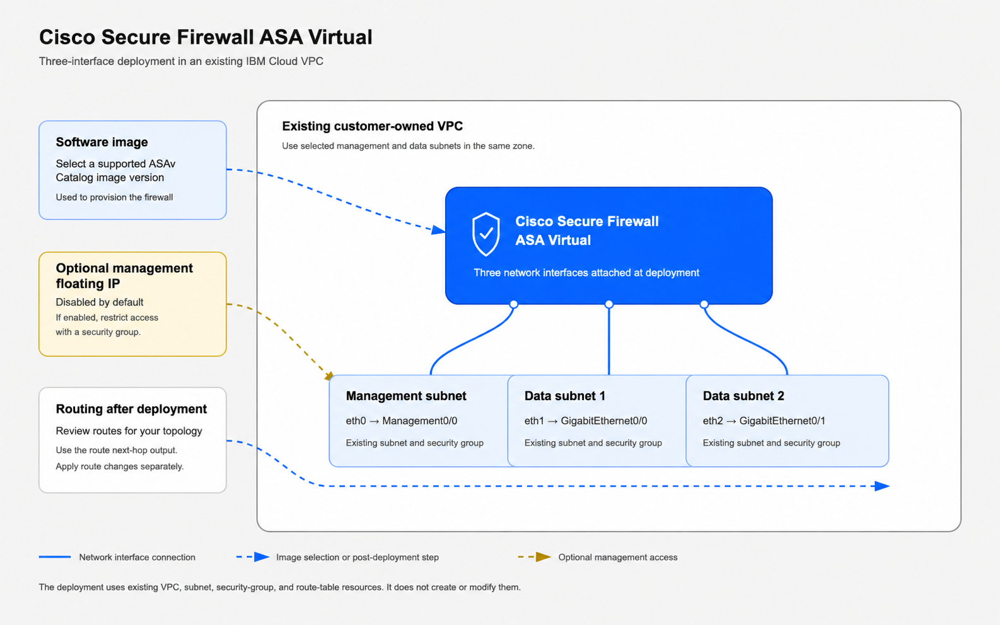

# Cisco Secure Firewall ASA Virtual — existing VPC

Deploy one three-interface ASAv from a Cisco VSI Catalog version into your existing IBM Cloud VPC. Obtain ASAv BYOL entitlement and eligible Cisco support separately.



| IBM interface | ASAv interface | Role |
|---|---|---|
| `eth0` (primary) | `Management0/0` | Management |
| `eth1` | `GigabitEthernet0/0` | Data-1; customer-defined |
| `eth2` | `GigabitEthernet0/1` | Data-2; customer-defined |

## Before you begin

### Prerequisites and IAM

Prepare an existing resource group, VPC, three distinct subnets in the same VPC/zone, security groups in that VPC, and at least one regional VPC SSH-key registration. The selected image/profile must be available in the zone, support three attachments and fit your account quota. Arrange a management access path.

| Scope | Required access |
|---|---|
| VPC Infrastructure Services | Platform **Administrator** is the verified built-in role for the default VNI settings. Scope access to the deployment resources where possible, with reads of existing VPCs, subnets, SGs, keys and profiles. |
| Selected Cisco VSI offering | Catalog read access and entitlement to consume the selected version. |
| Target resource group | Viewer access to resolve the group by name. |

Custom roles must include `is.virtual-network-interface.virtual-network-interface.manage-ip-spoofing` and `is.virtual-network-interface.virtual-network-interface.manage-protocol-state-filtering-mode`. The older instance IP-spoofing permission alone is insufficient. This template does not grant IAM access.

### Authentication and naming

Configure the deployment identity in the Software/Schematics flow. `ibmcloud_api_key` is an optional sensitive override; when omitted, the provider uses its environment/runtime credentials. For local Terraform, use `IC_API_KEY` or `IBMCLOUD_API_KEY`. Confirm the effective account and permissions. See [provider authentication](https://cloud.ibm.com/docs/ibm-cloud-provider-for-terraform?topic=ibm-cloud-provider-for-terraform-provider-reference).

Supply a unique deployment `prefix`: 1–35 lowercase letters, numbers or hyphens, starting with a letter, with no consecutive or trailing hyphens. Terraform adds resource labels such as `-vsi` and `-mgmt-vni`, without a random suffix. Change the default `cisco-asav` if it would collide.

### Network and first access

- Permit management SSH (TCP 22), and HTTPS/ASDM (TCP 443) when configured, only from approved administrator sources. A floating IP does not create SG rules or guest access policy.
- This image requires metadata enabled over **HTTP**, hop limit 1. Permit outbound TCP 80 from the management interface to `169.254.169.254/32`; HTTPS metadata is not supported by this package's image contract.
- With the default inputs, all three VNIs allow IP spoofing, disable protocol state filtering and enable infrastructure NAT. Customer SGs, ACLs, routes and ASAv policy still control the traffic path.

Customize [the Day-0 example](bootstrap/asav-day0.example.txt), including its inline RSA public key and SSH/AAA settings. Selecting IBM SSH-key IDs alone does not establish a usable guest login. If omitting Day-0, arrange console access or another verified first-configuration path. Submit raw text, not Base64.

`user_data` is sensitive but can remain in workspace/Terraform state. Keep private keys, API keys and reusable credentials out of the published package. See [IBM VPC user data](https://cloud.ibm.com/docs/vpc?topic=vpc-user-data).

### Image and runtime choices

Choose an `asav_image_version` label from [asav-images.json](asav-images.json). Omitted/null values use its `default_version`; an explicit retained label pins the image. Empty strings and arbitrary custom-image IDs/CRNs are not accepted. Use that entry's supported regions, profiles and Secure Boot modes; live profile availability is also checked during planning.

Defaults are `region = "us-east"`, `instance_profile = "cx3d-2x5"`, `enable_secure_boot = true` and `create_management_floating_ip = false`. Image compatibility lists do not change these input defaults. Requires Terraform `1.13.4` and IBM provider `2.4.0`. See [variables.tf](variables.tf) for the complete input schema.

## Required resources

Supply the resource group, VPC, three subnet/security-group pairs and regional SSH-key IDs. The template reads these existing resources; it creates the ASAv VSI, boot volume, three VNIs and optional management floating IP. It does not change existing subnets, security groups, ACLs, gateways or routes.

## Installing the software

1. Open the Software Terraform offer/version available to your account and configure the deployment workspace and identity.
2. Enter the existing-resource inputs, unique prefix, supported image/profile and your customized raw Day-0. Review the defaults and management access path.
3. Review the plan and available cost estimate, then deploy.
4. Inspect `selected_asav_image`, `interface_map` and `management_floating_ip`. Through management access, run `show version`, `show vm` and `show interface ip brief`; verify the guest version, hostname, interfaces and Day-0 results.
5. Configure licensing and guest policy, then follow the [routing guide](docs/routing-guide.md) before changing customer routes. Instance `running` status alone does not establish forwarding readiness.

For local deployment, use the pinned runtime and provider environment authentication. Keep variables/state outside the release package. Run `terraform init`, review `terraform plan`, apply the intended plan, then inspect `terraform output`. The Catalog Create form lists deployment values; [variables.tf](variables.tf) supplies the full local input reference.

### Production configuration

This package deploys one three-interface firewall. Establish guest policy/NAT, traffic routing, licensing, monitoring and configuration backups for your topology. HA, autoscaling and four/five-interface layouts are outside this package. Validate forwarding before introducing production routes; allowed compatibility choices do not prove every combination was boot-tested.

Restrict workspace/state access and protect state encryption. Preserve the same workspace/backend, state and source version for later operations. A directory rename does not migrate state; do not start an existing deployment from empty state.

### Outputs

Outputs include instance identity/status, zone, `selected_asav_image`, `secure_boot_enabled`, `management_floating_ip`, `interface_map` and `route_next_hops`. Next-hop outputs support a separate customer-reviewed routing change; see [outputs.tf](outputs.tf) for the full schema.

## Upgrading to a new version

See [changelog.txt](changelog.txt) for Software Terraform package history. Its version is separate from the VSI Catalog package and guest ASAv version.

Adopt a new package in the existing workspace/state and inspect the plan before applying. Omitted/null image labels follow the new package's default; pin a retained label when the image should remain unchanged. Changing the Terraform package does not perform an in-guest ASA upgrade.

With the pinned provider, Catalog image and Day-0 changes replace the VSI/boot volume; subnet/VNI changes can also replace resources. A profile change can interrupt service. Preserve guest configuration/licensing and plan a maintenance window. Automated rollback and zero-downtime upgrades are not provided.

Keep the original archive for recovery and destruction. If a new package removed your selected image label, restore the original package or a retained valid reference before planning/destroying. Do not silently retarget a historical label to another image.

## Uninstalling the software

Remove customer routes that depend on the firewall and preserve required guest configuration first. Use the original workspace/backend, inputs and state:

```bash
terraform plan -destroy -out=destroy.tfplan
terraform show destroy.tfplan
terraform apply destroy.tfplan
```

For Schematics, use **Destroy resources** and review its logs. Verify that the VSI, boot volume, three VNIs/reserved IPs and optional FIP are gone, while existing networks remain. Retain state until cleanup is confirmed, then delete the workspace if appropriate. Stopping a VM retains resources that can incur charges.

## Documentation and support

- [Cisco ASAv 9.24 Getting Started](https://www.cisco.com/c/en/us/td/docs/security/asa/asa924/asav/getting-started/asa-virtual-924-gsg/m_asav-intro.html)
- [ASA management access, SSH/AAA and ASDM](https://www.cisco.com/c/en/us/td/docs/security/asa/asa924/configuration/general/asa-924-general-config/admin-management.html)
- [Cisco licensing](https://www.cisco.com/c/en/us/td/docs/security/asa/asa924/configuration/general/asa-924-general-config/intro-license-smart.html)

Use [Cisco TAC](https://www.cisco.com/cisco/web/support/index.html) with an eligible support contract for ASAv, and IBM Cloud support for infrastructure, Catalog or Schematics incidents. Exclude credentials and raw state from support bundles.
