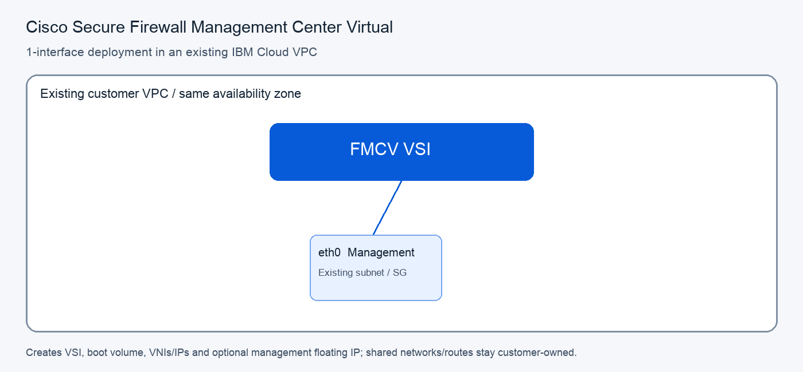

# Cisco Secure Firewall Management Center Virtual — existing VPC

Deploy one single-interface FMCv from an exact Cisco VSI Catalog version into an existing IBM Cloud VPC. Obtain BYOL entitlement and eligible Cisco support separately.



| IBM interface | Intended guest role |
|---|---|
| eth0 (primary) | Management |

FMCv is a management appliance. It has one management NIC and does not serve as a transit firewall. Deploy managed FTDv firewalls separately.

## Before you begin

Prepare an existing resource group, VPC, management subnet and security group in that VPC, and one VPC SSH key registered in the deployment region. Check quota, subnet free IPs, image access, and profile availability in the management subnet's zone.

Set **Resource name prefix** (`resource_name_prefix`) to a unique prefix of 1–35 lowercase letters, digits, or hyphens. Start with a letter and avoid consecutive or trailing hyphens. If the Catalog generates a value such as `cisco-fmcv-123ab` for a new install, you can edit it. Terraform uses the supplied value before resource suffixes such as `-vsi` and `-mgmt-vni`. Direct Terraform calls can still use the deprecated `prefix` input. If both inputs are omitted, Terraform uses `cisco-fmcv`.

### IAM and authentication

The deployment identity needs access to read the resource group, existing VPC/subnets/SGs/key/profiles and selected Catalog version, and to create/update/delete the VSI, boot volume, VNIs and optional floating IP. For Catalog deployment it also needs the applicable Schematics and Instance Management access. Scope permissions to the intended resources. This module creates no IAM policy.

The management VNI uses IP spoofing false, protocol state filtering auto and infrastructure NAT enabled. No forwarding variables or route-next-hop outputs are exposed.

Use provider runtime/environment credentials (local `IC_API_KEY` or `IBMCLOUD_API_KEY`); `ibmcloud_api_key` is an optional sensitive override. Keep credentials out of Git and variable files you publish. See [IBM provider authentication](https://cloud.ibm.com/docs/ibm-cloud-provider-for-terraform?topic=ibm-cloud-provider-for-terraform-provider-reference).

### Day-0 and first access

`user_data` accepts an optional raw JSON **object**. Null or blank values omit Day-0. Customize [the example](bootstrap/fmcv-day0.example.json) and replace every placeholder. Submit the JSON object as plain text without Base64 encoding or wrapping it in a JSON string.

For direct Day-0 entry in the Catalog, turn off **Use a secret?**, open **Edit secure value**, and paste the JSON object as plain text. To use an existing Secrets Manager secret, leave **Use a secret?** on and choose **Select from Secrets Manager**.

Customize the image-supported JSON, for example `AdminPassword` and `Hostname`. For unattended bootstrap, supply a strong `AdminPassword` and your hostname in Day-0. If Day-0 is absent, the qualified image accepts the registered SSH key but requires interactive CLI password setup. Its web-admin account is separate; complete web access using the image-supported setup procedure. See [Cisco's documented web-admin password procedure](https://www.cisco.com/c/en/us/support/docs/security/firesight-management-center/118631-technote-firesight-00.html). Do not assume a CLI password change updates the web account. The module does not configure FMC licensing, add managed devices or push policy. Before adding FTDv devices, initialize the applicable Smart Licensing or evaluation mode in FMC; a running FMC alone is insufficient for registration.

Selecting `ssh_key_id` supplies one IBM key registration to the VSI; guest SSH behavior remains image-specific. Do not assume that this alone configures a guest account. `user_data` is sensitive in Terraform but secrets may remain in state. Protect workspace/state access.

This image baseline uses metadata enabled over **HTTP**, response hop limit 1. Before first boot, allow outbound TCP 80 from the management interface to `169.254.169.254/32`. A missing metadata path can prevent first-boot configuration; reboot is not a reliable bootstrap retry. Restrict inbound SSH (22) and HTTPS (443) to approved sources as needed. The template does not add SG/ACL rules; a floating IP alone does not enable guest login. Allow the FMC–FTDv management connection between their management addresses (default TCP 8305; see [Cisco registration prerequisites](https://www.cisco.com/c/en/us/support/docs/security/firepower-ngfw/215540-configure-verify-and-troubleshoot-firep.html)). Provide routes and SG/ACL access to your chosen DNS/NTP servers and the Cisco HTTPS licensing/update endpoints required by enabled features.

### Image and runtime choices

[fmcv-images.json](fmcv-images.json) lists the image labels, compatible regions and profiles, and Secure Boot support. Omitting `fmcv_image_version` uses the packaged default. Supply a listed image label to pin the image. Terraform checks profile availability, NIC capacity, and Secure Boot support in the selected zone during planning.

The boot volume inherits the selected image's minimum size, recorded as `minimum_boot_volume_gb` in the image metadata.

See [version.tf](version.tf) for the supported Terraform runtime and pinned IBM provider. In Catalog, select the compatible Terraform runtime series. Schematics selects its patch. See [variables.tf](variables.tf) for input defaults and validation rules.

## Required resources

Terraform reads the existing resource group, VPC, management subnet, security group, and SSH key. It creates one VSI and boot volume, one management VNI with its primary reserved IP, and an optional management floating IP. Existing networks and SSH keys remain intact when the deployment is destroyed.

### Catalog deployment input checklist

1. **Required · Placement.** Set Deployment region, Resource name prefix, and Deployment resource group. Choose an existing VPC in Deployment region.
2. **Required · Management interface.** Select the management subnet and enter its security group ID. Both must belong to the selected VPC. If you change the VPC, reselect the subnet and enter the matching security group ID.
3. **Required · Access.** Choose one VPC SSH key registered in Deployment region. If you change regions, choose both the VPC and SSH key again for the new region.
4. **Required · Appliance.** Confirm the prefilled FMCv image and select a compatible virtual server profile.
5. **Optional · Management and tags.** Review the management floating IP, FMCv Day-0 configuration, and Appliance tags.

VPC and SSH key pickers can list resources from multiple regions. Match the region in each selection to Deployment region. If the form asks for an ID, enter one resource ID as a string. Local Terraform users supply `vpc_id` and `ssh_key_id` as individual string values. The Schematics workspace location, resource group, and tags apply to the workspace. Deployment region, Deployment resource group, and Appliance tags apply to the appliance resources.

## Installing the software

1. Select the reviewed Software/Terraform version and configure its workspace/identity.
2. Complete the Catalog deployment input checklist and review your management access path.
3. Review the plan and cost estimate. Apply only after image access and prerequisites are verified.
4. Allow first-boot initialization to finish before testing login. SSH and HTTPS can take about 30 minutes to become available. Check instance health, management access, `show version`, the management interface, and first-boot logs. Confirm the requested hostname, configuration, and image build.
5. Configure licensing, management/policy and backups. Read [the operations guide](docs/operations-guide.md). Running status alone does not establish appliance readiness.

For local use, keep input files/state outside the module. Example inputs (replace every placeholder):

```hcl
resource_group_name = "REPLACE_EXISTING_RG_NAME"
vpc_id = "REPLACE_VPC_ID"
region = "us-east"
resource_name_prefix = "fmcv-unique-deployment"
management_subnet_id = "REPLACE_MGMT_SUBNET_ID"
management_security_group_id = "REPLACE_MGMT_SG_ID"
ssh_key_id = "REPLACE_REGIONAL_KEY_ID"
```

```sh
terraform init
terraform plan -var-file=/secure/path/deployment.tfvars -out=/secure/path/deployment.tfplan
terraform apply /secure/path/deployment.tfplan
terraform output
```

### Production configuration

This package is a single appliance, without HA, autoscaling, multi-zone failover or automatic policy registration. Establish monitoring, backup/recovery, licensing, guest hardening and a management path. Add devices, configure policies and protect management access separately. Size for the supported device/event capacity of the chosen image/profile. Keep the same backend, state, inputs and source version for later operations.

IBM Cloud VPC uses host failure auto restart by default. After an unrecoverable host failure, IBM attempts to restart the FMCv on another host using the same volumes and IP addresses. Management access, FMC services, and device connectivity can be interrupted during recovery. Verify FMC health and managed-device connectivity after restart. See [IBM VPC host failure recovery policies](https://cloud.ibm.com/docs/vpc?topic=vpc-host-failure-recovery-policies).

Outputs include identity/status, zone, selected image metadata, interface map and management IPs, plus an HTTPS URL only when public management is enabled. See [outputs.tf](outputs.tf).

## Upgrading to a new version

**Initial qualified scope:** deployment, management access, device registration/policy deployment, no-op/tag/floating-IP updates and destruction. FMCv VSI replacement, image migration and backup/restore recovery are explicitly outside this release's qualified scope. The following change-impact guidance is not evidence that those recovery operations have been qualified.

See [changelog.txt](changelog.txt). Adopt new source in the existing workspace/state and inspect the plan. Package version and guest software upgrade are separate. Null image input follows the new packaged default; retain an explicit label to pin an image. Do not retarget an existing label silently.

When migrating an existing deployment that uses `prefix`, keep that value or copy it exactly to `resource_name_prefix`. If the original deployment used the Terraform default, preserve `cisco-fmcv`. Both keys can be set to the same value during migration. Terraform rejects conflicting values. Confirm the plan shows no resource changes caused by the input rename.

The pinned provider marks Catalog version and user-data changes for VSI replacement; subnet/VNI changes can replace resources, and profile changes can interrupt service. Preserve configuration/licensing/backups and schedule a maintenance window. No automatic rollback or zero-downtime upgrade is provided. Keep the original archive and a valid image reference for recovery and destroy.

## Uninstalling the software

Preserve backups and consider managed-device dependencies before removal. Use the original workspace/backend and inputs:

```sh
terraform plan -destroy -var-file=/secure/path/deployment.tfvars -out=/secure/path/destroy.tfplan
terraform apply /secure/path/destroy.tfplan
terraform state list
```

Expected owned resources are removed, including the boot volume, optional FIP, standalone VNIs and their reserved IPs. Confirm this in the target region and check for billable remnants after errors; do not delete shared resources. Never discard state to resolve a failed destroy. Repeat the cleanup verification when qualifying a new package version.

## Support

Use your Cisco support entitlement for appliance software and IBM Cloud support for infrastructure/Schematics. See [Cisco FMCv documentation](https://www.cisco.com/c/en/us/support/security/defense-center-virtual-appliance/series.html). Include sanitized version, image reference and deployment diagnostics; never send secrets or private keys.

## Source license

These Terraform deployment templates are licensed under Apache License 2.0. The deployment archive includes the repository's `LICENSE` and `NOTICE` files. Cisco appliance software images, BYOL entitlements and support remain subject to their applicable Cisco terms; the template source license does not change those terms.
