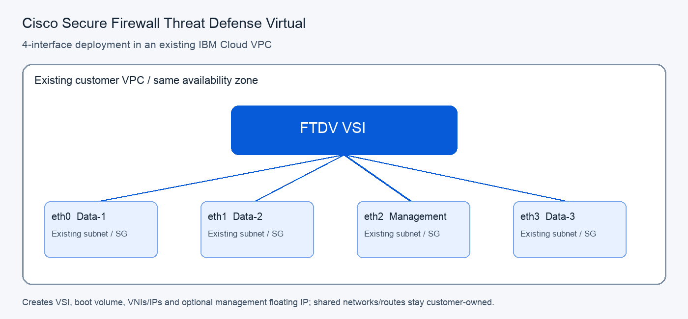

# Cisco Secure Firewall Threat Defense Virtual — existing VPC

Deploy one four-interface FTDv from an exact Cisco VSI Catalog version into an existing IBM Cloud VPC. Obtain BYOL entitlement and eligible Cisco support separately.



| IBM interface | Intended guest role |
|---|---|
| eth0 (primary) | Data-1 (inside example) |
| eth1 | Data-2 (outside example) |
| eth2 | Management |
| eth3 | Data-3 (customer-defined) |

FTDv uses three data NICs and management at eth2, with **Diagnostic OFF**. Terraform requests all four attachments when it creates the VSI. Match guest data interfaces to IBM eth0, eth1, and eth3 using their MAC addresses. Recheck the mapping when changing the backing image.

## Before you begin

Prepare an existing resource group, VPC, four distinct subnets in the same VPC and availability zone, security groups in that VPC, and one regional VPC SSH key. You can reuse security groups where appropriate. Check account quota, available subnet IPs, image access, and profile availability.

### IAM, authentication, and naming

The deployment identity needs access to read the resource group, existing VPC/subnets/SGs/key/profiles and selected Catalog version, and to create/update/delete the VSI, boot volume, VNIs and optional floating IP. For Catalog deployment it also needs the applicable Schematics and Instance Management access. Scope permissions to the intended resources. This module creates no IAM policy.

The three data VNIs default to IP spoofing **true** and protocol state filtering **disabled**. Management uses false/auto. The execution identity needs the native VNI actions `is.virtual-network-interface.virtual-network-interface.manage-ip-spoofing` and `is.virtual-network-interface.virtual-network-interface.manage-protocol-state-filtering-mode`. Catalog IAM declarations document access; they do not grant it. An explicit `data_interface_allow_ip_spoofing=false` can support boot-only tests with insufficient spoofing permission; it is not a forwarding qualification or an automatic fallback.

Use provider runtime/environment credentials (local `IC_API_KEY` or `IBMCLOUD_API_KEY`); `ibmcloud_api_key` is an optional sensitive override. Keep credentials out of Git and variable files you publish. See [IBM provider authentication](https://cloud.ibm.com/docs/ibm-cloud-provider-for-terraform?topic=ibm-cloud-provider-for-terraform-provider-reference).

Set **Resource name prefix** (`resource_name_prefix`) to a unique prefix of 1–35 lowercase letters, digits, or hyphens. Start with a letter and avoid consecutive or trailing hyphens. If the Catalog generates a value such as `cisco-ftdv-123ab` for a new install, you can edit it. Terraform uses the supplied value before resource suffixes such as `-vsi` and `-mgmt-vni`. Direct Terraform callers can still use the deprecated `prefix` input. If both inputs are omitted, Terraform uses `cisco-ftdv`.

### Day-0 and first access

`user_data` accepts an optional raw JSON **object**, not Base64 or a JSON-encoded string. Null/blank omits it. Customize [the example](bootstrap/ftdv-day0.example.json); replace placeholders before use. It is a schema example, not a complete secure appliance configuration. No shared password is supplied.

For manual Day-0 entry in the Catalog secure editor, turn off **Use a secret?**, open **Edit secure value**, and paste the JSON object as plain text. To use an existing Secrets Manager secret, leave **Use a secret?** on and choose **Select from Secrets Manager**.

The optional payload may contain image-supported FMC registration fields (`FmcIp`, `FmcRegKey`, `FmcNatId`) and other image-supported fields. The module passes it unchanged; it does not create an FMC, call its API or complete FMC-side Add Device. Omit those fields for later manual registration. A supplied `Diagnostic` field must be the string `OFF`; the image contract must also preserve Diagnostic OFF when Day-0 is absent. Null/blank Day-0 remains allowed. In the initial image test the registered SSH key was accepted, but the guest required interactive password setup before opening the CLI. Arrange that image-supported setup path; omission is not an unattended ready-to-use deployment.

For optional Day-0 registration, merge the following fields into your complete image-supported JSON (use a real reachable manager and customer-specific registration values):

```json
{
  "FmcIp": "192.0.2.10",
  "FmcRegKey": "<customer-registration-key>",
  "FmcNatId": "<customer-nat-id>"
}
```

This fragment does not replace the complete password/hostname configuration. Manager-side Add Device and successful registration must still be verified. The FMC must have its applicable Smart Licensing or evaluation mode initialized before it accepts a managed FTDv device.

Selecting `ssh_key_id` supplies one IBM key registration to the VSI; guest SSH behavior remains image-specific. Do not assume that this alone configures a guest account. `user_data` is sensitive in Terraform but secrets may remain in state. Protect workspace/state access.

This image baseline uses metadata enabled over **HTTP**, response hop limit 1. Before first boot, allow outbound TCP 80 to `169.254.169.254/32` on the bootstrap path. FTDv can fetch metadata through a data NIC before management is configured. Prepare this narrow egress allowance in all four selected SGs and applicable ACLs unless the exact image bootstrap path has been qualified more narrowly; a management-only allowance can be insufficient. A missing metadata path can prevent first-boot configuration; reboot is not a reliable bootstrap retry. Restrict inbound SSH (22) to approved administrator sources. The template does not add SG/ACL rules; a floating IP alone does not enable guest login. Allow the FMC–FTDv management connection between their management addresses (default TCP 8305; see [Cisco registration prerequisites](https://www.cisco.com/c/en/us/support/docs/security/firepower-ngfw/215540-configure-verify-and-troubleshoot-firep.html)). Provide routes and SG/ACL access to your chosen DNS/NTP servers and the Cisco HTTPS licensing/update endpoints required by enabled features.

### Image and runtime choices

[ftdv-images.json](ftdv-images.json) lists the image labels, compatible regions and profiles, and Secure Boot support. Omitting `ftdv_image_version` uses the packaged default. Supply a listed image label to pin the image. Terraform checks profile availability, NIC capacity, and Secure Boot support in the selected zone during planning.

The boot volume inherits the selected image's minimum size, recorded as `minimum_boot_volume_gb` in the image metadata.

See [version.tf](version.tf) for the supported Terraform runtime and pinned IBM provider. In Catalog, select the compatible Terraform runtime series. Schematics selects its patch. See [variables.tf](variables.tf) for input defaults and validation rules.

## Required resources

Existing: resource group, VPC, four distinct subnet IDs and four SG selections, and one **string** `ssh_key_id` (no array brackets). Owned: one VSI/boot volume, 4 VNIs with their primary reserved IPs, and optionally one management floating IP. Existing VPCs, subnets, SGs, ACLs, keys, gateways and route tables are read only and survive destruction.

### Catalog deployment input checklist

1. **Required · Placement.** Set Deployment region, Resource name prefix, and Deployment resource group. Choose an existing VPC in Deployment region.
2. **Required · Network interfaces.** Select a subnet and enter its security group ID for each interface (management, data 1, data 2, and data 3). Use four distinct subnets in the selected VPC and the same availability zone. If you change the VPC, reselect the subnets and enter the matching security group IDs.
3. **Required · Access.** Choose one VPC SSH key registered in Deployment region. If you change regions, choose both the VPC and SSH key again for the new region.
4. **Required · Appliance.** Confirm the FTDv image and select a compatible virtual server profile.
5. **Optional · Management and tags.** Review the management floating IP, FTDv Day-0 configuration, and Appliance tags.

When a picker lists resources from multiple regions, match the region of each selection to Deployment region. If the form asks for an ID, enter a single string. Direct Terraform callers supply `vpc_id` and `ssh_key_id` as individual string values. Schematics workspace location, resource group, and tags apply to the workspace. Deployment region, Deployment resource group, and Appliance tags apply to the appliance resources.

## Installing the software

1. Select the reviewed Software/Terraform version and configure its workspace/identity.
2. Complete the Catalog deployment input checklist and review your management access path.
3. Review the plan and cost estimate. Apply only after image access and prerequisites are verified.
4. Check instance health, management access, `show version`, `show network` and `show vm`, actual interface roles and first-boot logs. Confirm the requested hostname/configuration and image build.
5. Configure licensing, management/policy and backups. Read [the operations guide](docs/operations-guide.md). Running status alone does not establish appliance readiness.

For local use, keep input files/state outside the module. Example inputs (replace every placeholder):

```hcl
resource_group_name = "REPLACE_EXISTING_RG_NAME"
vpc_id = "REPLACE_VPC_ID"
region = "us-east"
resource_name_prefix = "ftdv-unique-deployment"
management_subnet_id = "REPLACE_MGMT_SUBNET_ID"
management_security_group_id = "REPLACE_MGMT_SG_ID"
ssh_key_id = "REPLACE_REGIONAL_KEY_ID"
data_subnet_1_id = "REPLACE_DATA_1_SUBNET_ID"
data_security_group_1_id = "REPLACE_DATA_1_SG_ID"
data_subnet_2_id = "REPLACE_DATA_2_SUBNET_ID"
data_security_group_2_id = "REPLACE_DATA_2_SG_ID"
data_subnet_3_id = "REPLACE_DATA_3_SUBNET_ID"
data_security_group_3_id = "REPLACE_DATA_3_SG_ID"
```

```sh
terraform init
terraform plan -var-file=/secure/path/deployment.tfvars -out=/secure/path/deployment.tfplan
terraform apply /secure/path/deployment.tfplan
terraform output
```

### Production configuration

This package is a single appliance, without HA, autoscaling, multi-zone failover or automatic policy registration. Establish monitoring, backup/recovery, licensing, guest hardening and a management path. Configure all data interfaces, guest forwarding/security policy and customer routing separately; verify bidirectional traffic before diverting production flows. Keep the same backend, state, inputs and source version for later operations.

IBM Cloud VPC uses host failure auto restart by default. After an unrecoverable host failure, IBM attempts to restart FTDv on another host in the same zone using the same volumes and IP addresses. Forwarding and management can be interrupted. After recovery, verify interface status, FMC connectivity, and traffic flow. See [IBM VPC host failure recovery policies](https://cloud.ibm.com/docs/vpc?topic=vpc-host-failure-recovery-policies).

Outputs include identity/status, zone, selected image metadata, interface map and management IPs, plus three data route-next-hop addresses. See [outputs.tf](outputs.tf).

## Upgrading to a new version

See [changelog.txt](changelog.txt). Adopt new source in the existing workspace/state and inspect the plan. Package version and guest software upgrade are separate. Null image input follows the new packaged default; retain an explicit label to pin an image. Do not retarget an existing label silently.

When migrating an existing deployment that uses `prefix`, keep that value or copy it exactly to `resource_name_prefix`. If the original deployment used the Terraform default, preserve `cisco-ftdv`. Both keys can be set to the same value during migration. Terraform rejects conflicting values. Confirm the plan shows no resource changes caused by the input rename.

The pinned provider marks Catalog version and user-data changes for VSI replacement; subnet/VNI changes can replace resources, and profile changes can interrupt service. Preserve configuration/licensing/backups and schedule a maintenance window. No automatic rollback or zero-downtime upgrade is provided. Keep the original archive and a valid image reference for recovery and destroy.

## Uninstalling the software

Remove customer routes pointing at the firewall and preserve its configuration first. Use the original workspace/backend and inputs:

```sh
terraform plan -destroy -var-file=/secure/path/deployment.tfvars -out=/secure/path/destroy.tfplan
terraform apply /secure/path/destroy.tfplan
terraform state list
```

Expected owned resources are removed, including the boot volume, optional FIP, standalone VNIs and their reserved IPs. Confirm this in the target region and check for billable remnants after errors; do not delete shared resources. Never discard state to resolve a failed destroy. Repeat the cleanup verification when qualifying a new package version.

## Support

Use your Cisco support entitlement for appliance software and IBM Cloud support for infrastructure/Schematics. See [Cisco FTDv documentation](https://www.cisco.com/c/en/us/support/security/firepower-ngfw-virtual/series.html). Include sanitized version, image reference and deployment diagnostics; never send secrets or private keys.

## Source license

These Terraform deployment templates are licensed under Apache License 2.0. The deployment archive includes the repository's `LICENSE` and `NOTICE` files. Cisco appliance software images, BYOL entitlements and support remain subject to their applicable Cisco terms; the template source license does not change those terms.
